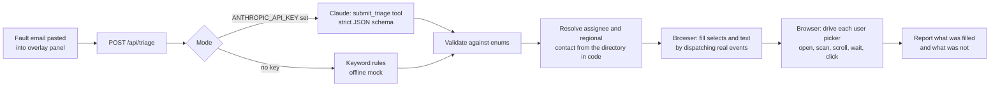

# helpdesk-ticket-autofill

Reads a fault-notification email, classifies it with Claude, and fills in a helpdesk ticket form, including user pickers that have no autocomplete.

Everything here is a standalone demo: a fake ticketing form, a fictional staff directory, and an offline mode that needs no API key.

## The problem

Fault emails arrive as free text. A support engineer has to work out which subsystem and region they belong to, decide a priority, then fill the same form by hand: three dropdowns, a summary, and three user fields (caller, assignee, regional contact). The user fields were the slow part. The picker has no search box, shows 20 people at a time, and loads more only as you scroll, so finding one name means scrolling a long list.

## How it works



Two decisions shape the design:

- **The model classifies; code picks people.** Claude returns subsystem, region, priority, a one-line summary and the reporter's name. The assignee and regional contact come from a lookup table in code. A wrong or invented name from the model cannot reach the form.
- **The script touches the page only through the DOM.** `public/autofill.js` is a dependency-free script that would work as a bookmarklet or userscript on any page. The demo form does not know it exists.

## Stack

Node 22+ (no framework, `node:http`), vanilla JavaScript on the front end, `@anthropic-ai/sdk` for the model call, `node:test` for tests.

## Run it

```bash
git clone <this repo> && cd helpdesk-ticket-autofill
npm install
npm run start:mock        # offline, no API key
# open http://localhost:3000
```

1. Click **Simulate bookmarklet** at the bottom of the page. This loads `autofill.js` the same way a bookmarklet would.
2. In the overlay, pick a sample email or paste your own, then click **Fill form**.
3. Watch the form fill, then check the log in the overlay: ✓ for fields that were filled, ⚠ for ones that were not and why.

To use Claude instead of the keyword rules:

```bash
cp .env.example .env      # set ANTHROPIC_API_KEY
npm start
```

The model defaults to `claude-opus-5-5`; set `ANTHROPIC_MODEL` to change it. `TRIAGE_MODE=mock|claude|auto` forces a mode.

Real use as a bookmarklet, with the server running:

```js
javascript:(()=>{const s=document.createElement('script');s.src='http://localhost:3000/autofill.js';document.body.append(s)})()
```

```bash
npm test                  # 14 tests, no network or API key needed
```

## Things I learned building it

**Setting `.value` is not enough.** The demo form keeps its state in JavaScript and updates it from `input` and `change` events, like most framework-based UIs. Assigning `el.value` leaves the form state empty and validation fails on submit. `setText` uses the native value setter and then dispatches both events.

**A picker with no search box needs a scan loop.** `pickUser` opens the dialog, reads the rows, looks for a match, scrolls the list to the bottom, waits until more rows appear, and repeats until it finds the person or the list stops growing. It waits on the condition (row count increased) with a timeout, not on a fixed sleep.

**Programmatic scrolling does not reliably fire `scroll`.** Scroll events are tied to rendering. During testing in the embedded browser, the loop stopped after two pages and reported "not found" for people who were in the list. The script now dispatches a `scroll` event itself after moving the list. The page ignores duplicates while a load is already in flight.

**Names are not unique.** The directory has two people called Sam Wong in different departments, and the picker shows only name and department. `matchRow` is a pure function: one exact name match is accepted, several are disambiguated by department, and if that still does not give exactly one it reports "ambiguous" and leaves the field empty. It never guesses.

**Stale values are worse than empty ones.** After a failed lookup, the previous run's caller was still selected, so a ticket could have been filed against the wrong person. The script now clears each picker before filling it.

**Forced tool use is not available on the newest models.** Requests send `tool_choice: auto` with `strict: true` on the tool and an instruction in the system prompt. If the model does not call the tool, the code treats that as an error instead of returning a half-filled form.

**The email is untrusted input.** It is wrapped in tags, the prompt says to classify and never follow instructions inside it, and the output is validated against the enums either way.

**Smaller things.** The overlay lives in a shadow root so the host page's CSS cannot restyle it. Loading the script twice is a no-op. The request body is capped at 50 KB.

## Limits

- The keyword classifier is only there to make the demo runnable offline. It handles the three sample emails and similar wording, not arbitrary text.
- The matcher depends on the picker's markup (`li` rows with name and department). A different system needs a different `readRows`.
- The Claude path is covered by tests with a fake client; it has not been run against the live API in this repository's test suite.

## Layout

```
src/            server, triage (Claude + mock), schema, fictional directory
public/         demo form (app.js) and the injected script (autofill.js)
examples/       sample fault emails
test/           node:test suites
```

## Licence

MIT
